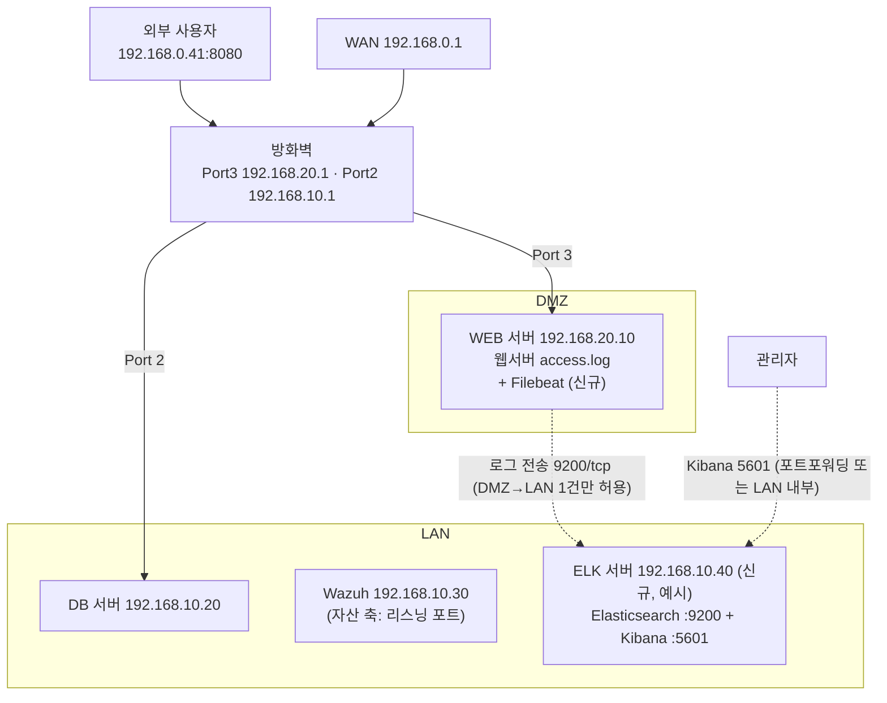

# ELK 구축 가이드라인 — Shadow API 탐지 + 대시보드 (비컨테이너)

> 전제: 도커·쿠버네티스 없음, Linux(Ubuntu/Debian 계열 가정) 서버에 패키지로 설치.
> **`192.168.10.40`(ELK 서버), 웹서버 종류·로그 경로는 예시** — README의 "확인 필요" 항목을 채운 뒤 바꿔 쓴다.
> 버전은 설치 시점의 Elastic 공식 문서를 기준으로 하고, 본 문서의 명령은 8.x/9.x 공통 절차를 따른다.

---

## 0. 목표 구성



데이터 흐름:

```
access.log ─Filebeat─▶ [ingest pipeline: api-access]
                         ① 로그 파싱 (메서드·경로·상태코드·IP)
                         ② 경로 정규화  /users/123 → /users/{id}
                         ③ api-inventory(명세)와 enrich 대조
                         ④ api.classification = documented | shadow | zombie
                       ─▶ Elasticsearch ─▶ Kibana 대시보드
```

## 1. 사전 준비

### 1-1. ELK 서버 사양 (단일 노드, 파일럿 기준)

| 항목 | 최소 | 비고 |
|---|---|---|
| CPU | 4 vCPU | |
| RAM | 8 GB | JVM 힙 4GB + OS 파일 캐시 |
| 디스크 | 100 GB SSD | 로그량에 따라 조정, 보관 30일 기준 |
| 위치 | LAN (192.168.10.0/24) | Wazuh indexer도 9200을 쓰므로 **Wazuh 서버와 같은 VM에 두지 않는다** |

### 1-2. 방화벽 정책 추가

| 출발 | 도착 | 포트 | 목적 |
|---|---|---|---|
| 192.168.20.10 (WEB) | 192.168.10.40 (ELK) | 9200/tcp | Filebeat 로그 전송 — **DMZ→LAN 유일한 신규 허용** |
| 관리자 PC / 포트포워딩 | 192.168.10.40 | 5601/tcp | Kibana 접속 (예: `192.168.0.41:8083 → :5601`) |

- DMZ→LAN 허용은 출발지 IP·포트를 이 한 줄로 제한한다. WEB이 침해돼도 ELK에 **쓰기만** 가능하도록 4-2의 최소 권한 API 키를 쓴다.
- 9200을 외부(WAN)에 열지 않는다.

### 1-3. WEB 서버 액세스 로그 확인

로그에 **메서드, 경로(쿼리 포함), 상태코드, 클라이언트 IP, 시각**이 남는지 확인한다.

| 웹서버 | 기본 로그 경로 | 기본 포맷 |
|---|---|---|
| Nginx | `/var/log/nginx/access.log` | combined |
| Apache (Ubuntu) | `/var/log/apache2/access.log` | combined |
| Apache (RHEL) | `/var/log/httpd/access_log` | combined |
| Tomcat | `<tomcat>/logs/localhost_access_log.*.txt` | common (referrer·UA 없음 — 파이프라인이 둘 다 처리) |

- 앞단에 프록시(Nginx 등)가 있고 뒤에 WAS가 있다면 **가장 바깥 웹서버의 로그**를 수집한다.
- 응답시간도 보고 싶다면 로그 포맷 끝에 `$request_time`(Nginx) / `%D`(Apache)를 추가하고 3-1의 grok 패턴에 필드를 덧붙인다.

---

## 2. Elasticsearch 설치 (ELK 서버)

```bash
# Elastic APT 저장소 등록 (9.x 기준 — 사용할 메이저 버전에 맞춰 경로 변경)
wget -qO - https://artifacts.elastic.co/GPG-KEY-elasticsearch | sudo gpg --dearmor -o /usr/share/keyrings/elastic.gpg
echo "deb [signed-by=/usr/share/keyrings/elastic.gpg] https://artifacts.elastic.co/packages/9.x/apt stable main" \
  | sudo tee /etc/apt/sources.list.d/elastic.list
sudo apt update && sudo apt install elasticsearch
```

설치 출력에 **`elastic` 사용자 초기 비밀번호**가 표시된다. 안전한 곳에 보관한다(분실 시 `/usr/share/elasticsearch/bin/elasticsearch-reset-password -u elastic`).

`/etc/elasticsearch/elasticsearch.yml` 수정:

```yaml
cluster.name: api-monitoring
node.name: elk-01
network.host: 192.168.10.40
http.port: 9200
# 보안(xpack.security.*)과 TLS는 설치 시 자동 구성됨 — 그대로 둔다
```

JVM 힙 (`/etc/elasticsearch/jvm.options.d/heap.options`):

```
-Xms4g
-Xmx4g
```

```bash
sudo systemctl daemon-reload
sudo systemctl enable --now elasticsearch
curl --cacert /etc/elasticsearch/certs/http_ca.crt -u elastic https://192.168.10.40:9200
```

## 3. Kibana 설치 (ELK 서버)

```bash
sudo apt install kibana
```

`/etc/kibana/kibana.yml`:

```yaml
server.host: "192.168.10.40"
server.port: 5601
```

```bash
# Elasticsearch와 연결 (enrollment token 방식)
TOKEN=$(sudo /usr/share/elasticsearch/bin/elasticsearch-create-enrollment-token -s kibana)
sudo /usr/share/kibana/bin/kibana-setup --enrollment-token "$TOKEN"
sudo systemctl enable --now kibana
```

브라우저에서 `http://192.168.10.40:5601` → `elastic` 계정으로 로그인.
이후 4~6장의 API 요청은 **Kibana > Dev Tools** 콘솔에 붙여 넣어 실행한다.

---

## 4. 명세(API 인벤토리) 적재 — "명세 축"

### 4-1. 인벤토리 인덱스 생성

```json
PUT api-inventory
{
  "mappings": {
    "properties": {
      "endpoint_key": { "type": "keyword" },
      "service":      { "type": "keyword" },
      "owner":        { "type": "keyword" },
      "status":       { "type": "keyword" }
    }
  }
}
```

`endpoint_key` 규칙: `"<METHOD> <정규화 경로>"` — 예: `GET /api/users/{id}`
`status`: `active` 또는 `deprecated` (deprecated가 관측되면 Zombie로 분류됨)

### 4-2. OpenAPI 명세 → 인벤토리 변환·적재

```bash
pip install pyyaml   # 명세가 YAML일 때만 필요 (JSON이면 생략)
python tools/openapi_to_inventory.py openapi.yaml shop-api 개발1팀 /api > inventory.ndjson
curl --cacert http_ca.crt -u elastic -X POST "https://192.168.10.40:9200/api-inventory/_bulk" \
     -H "Content-Type: application/x-ndjson" --data-binary @inventory.ndjson
```

- 4번째 인자 `/api`는 명세 `servers.url`의 경로 prefix(있을 때만).
- Windows Git Bash에서 실행할 때는 `/api`가 Windows 경로로 바뀌므로 앞에 `MSYS_NO_PATHCONV=1`을 붙인다.
- 명세가 없는 서비스는 일단 **비워 둔다** — 그 서비스의 API는 전부 shadow로 잡히며, 이게 곧 "명세 작성이 필요한 목록"이 된다.

### 4-3. Enrich 정책 생성·실행

```json
PUT _enrich/policy/api-inventory-policy
{
  "match": {
    "indices": "api-inventory",
    "match_field": "endpoint_key",
    "enrich_fields": ["service", "owner", "status"]
  }
}

POST _enrich/policy/api-inventory-policy/_execute
```

> ⚠️ **인벤토리를 수정할 때마다 `_execute`를 다시 실행**해야 반영된다 (enrich는 스냅샷 방식).

---

## 5. 수집 파이프라인 — 파싱 · 정규화 · 분류

```json
PUT _ingest/pipeline/api-access
{
  "description": "웹 액세스 로그 파싱 → 경로 정규화 → 명세 대조",
  "processors": [
    { "grok": {
        "field": "message",
        "patterns": [
          "%{IPORHOST:source.ip} %{NOTSPACE:ident} %{NOTSPACE:user.name} \\[%{HTTPDATE:access_ts}\\] \"%{WORD:http.request.method} %{NOTSPACE:url.original} HTTP/%{NUMBER:http.version}\" %{NUMBER:http.response.status_code:int} (?:%{NUMBER:http.response.body.bytes:long}|-)(?: \"%{DATA:http.request.referrer}\" \"%{DATA:user_agent.original}\")?.*"
        ]
    }},
    { "date":   { "field": "access_ts", "formats": ["dd/MMM/yyyy:HH:mm:ss Z"] } },
    { "remove": { "field": ["access_ts", "ident"], "ignore_missing": true } },

    { "set":  { "field": "url.path", "copy_from": "url.original" } },
    { "gsub": { "field": "url.path", "pattern": "\\?.*$", "replacement": "" } },

    { "set":  { "field": "api.endpoint", "copy_from": "url.path" } },
    { "gsub": { "field": "api.endpoint", "pattern": "[0-9a-fA-F]{8}-[0-9a-fA-F]{4}-[0-9a-fA-F]{4}-[0-9a-fA-F]{4}-[0-9a-fA-F]{12}", "replacement": "{id}" } },
    { "gsub": { "field": "api.endpoint", "pattern": "/[0-9a-fA-F]{16,}(?=/|$)", "replacement": "/{id}" } },
    { "gsub": { "field": "api.endpoint", "pattern": "/\\d+(?=/|$)", "replacement": "/{id}" } },
    { "gsub": { "field": "api.endpoint", "pattern": "(?<=.)/$", "replacement": "" } },

    { "set":    { "field": "api.endpoint_key", "value": "{{http.request.method}} {{api.endpoint}}" } },
    { "enrich": { "policy_name": "api-inventory-policy", "field": "api.endpoint_key", "target_field": "api.inventory", "ignore_missing": true } },
    { "script": {
        "source": "if (ctx.api.inventory == null) { ctx.api.classification = 'shadow'; } else if (ctx.api.inventory.status == 'deprecated') { ctx.api.classification = 'zombie'; } else { ctx.api.classification = 'documented'; }"
    }}
  ],
  "on_failure": [
    { "set": { "field": "error.message", "value": "{{ _ingest.on_failure_message }}" } }
  ]
}
```

### 5-1. 배포 전 시뮬레이션 (필수)

```json
POST _ingest/pipeline/api-access/_simulate
{
  "docs": [
    { "_source": { "message": "203.0.113.5 - - [29/Oct/2026:10:00:00 +0900] \"GET /api/users/123/orders/550e8400-e29b-41d4-a716-446655440000?x=1 HTTP/1.1\" 200 512 \"-\" \"curl/8.0\"" } },
    { "_source": { "message": "203.0.113.5 - - [29/Oct/2026:10:00:01 +0900] \"POST /debug/reset HTTP/1.1\" 404 0" } }
  ]
}
```

기대 결과: 첫 줄 `api.endpoint_key = "GET /api/users/{id}/orders/{id}"`, 두 번째 줄 `api.classification = "shadow"`.

### 5-2. 정규화 규칙의 한계

| 상황 | 결과 | 대응 |
|---|---|---|
| 경로 파라미터가 문자열 (`/users/alice`) | 정규화 안 됨 → shadow 오탐 | 해당 패턴용 `gsub`를 추가 (예: `/users/[^/]+` → `/users/{id}`) |
| 명세의 경로 prefix 누락 | 전부 shadow로 잡힘 | 4-2의 prefix 인자 확인 |
| 정적 파일 (`/css/...`, `/favicon.ico`) | shadow로 잡힘 | 대시보드에서 제외 필터, 또는 파이프라인에서 `drop` 처리 |

---

## 6. Filebeat 설치 (WEB 서버 192.168.20.10)

### 6-1. 전송 전용 API 키 발급 (Kibana Dev Tools)

```json
POST /_security/api_key
{
  "name": "filebeat-web-dmz",
  "role_descriptors": {
    "filebeat_writer": {
      "cluster": ["monitor", "read_ilm", "read_pipeline"],
      "index": [{ "names": ["filebeat-*"], "privileges": ["view_index_metadata", "create_doc", "auto_configure"] }]
    }
  }
}
```

응답의 `id`와 `api_key`를 `id:api_key` 형태로 사용한다. 이 키는 **문서 쓰기만** 가능하다.

### 6-2. 설치 및 설정

```bash
# 2장과 같은 방식으로 Elastic APT 저장소 등록 후
sudo apt install filebeat
# ELK 서버의 /etc/elasticsearch/certs/http_ca.crt 를 WEB 서버 /etc/filebeat/http_ca.crt 로 복사
```

`/etc/filebeat/filebeat.yml`:

```yaml
filebeat.inputs:
  - type: filestream
    id: web-access
    paths:
      - /var/log/nginx/access.log      # 1-3에서 확인한 경로로 변경
    pipeline: api-access
    fields:
      zone: dmz
      host_role: web

output.elasticsearch:
  hosts: ["https://192.168.10.40:9200"]
  api_key: "<id>:<api_key>"
  ssl.certificate_authorities: ["/etc/filebeat/http_ca.crt"]
```

```bash
# 인덱스 템플릿 등 초기 설정은 1회만 관리자 계정으로:
# filebeat.yml의 api_key 줄을 잠시 주석 처리한 뒤 실행하고, 끝나면 주석을 되돌린다
sudo filebeat setup --index-management \
  -E output.elasticsearch.username=elastic -E output.elasticsearch.password='<비밀번호>'

sudo filebeat test config && sudo filebeat test output
sudo systemctl enable --now filebeat
```

### 6-3. 수집 확인

```json
GET filebeat-*/_search
{
  "size": 0,
  "aggs": { "by_class": { "terms": { "field": "api.classification" } } }
}
```

`documented / shadow / zombie` 건수가 나오면 성공. `error.message`가 있는 문서는 grok 패턴 불일치 → 로그 포맷 재확인.

---

## 7. 보관 정책 (ILM)

**Kibana > Stack Management > Index Lifecycle Policies > `filebeat`** 정책 수정:
- Hot: 롤오버 기본값 유지
- Delete: **30일 후 삭제** (보관 기간은 내부 정책에 맞춰 조정)

---

## 8. Kibana 대시보드

**Stack Management > Data Views**에서 `filebeat-*` 데이터 뷰 생성 (시간 필드 `@timestamp`).
**Dashboards > Create**에서 Lens로 아래 패널 구성:

| # | 패널 | 시각화 | 설정 |
|---|---|---|---|
| 1 | 분류별 요청 수 | Metric ×3 | `api.classification` = documented / shadow / zombie 각각 Count |
| 2 | 분류별 추이 | 누적 막대(시간축) | X: `@timestamp`, 분할: `api.classification` |
| 3 | **Shadow API 목록** | Table | 필터 `api.classification: shadow` · 행: `api.endpoint_key` · 열: Count, Min `@timestamp`(최초 발견), Max `@timestamp`(최근), Unique count `source.ip` |
| 4 | Zombie API 목록 | Table | 필터 `api.classification: zombie` · 행: `api.endpoint_key`, `api.inventory.owner` · 열: Count, Max `@timestamp` |
| 5 | 상태코드 분포 | 도넛 | `http.response.status_code` |
| 6 | 호출 상위 IP | 막대 | `source.ip` Top 10 (shadow 필터 적용 버전도 추가) |
| 7 | 전체 트래픽 | 라인 | Count over `@timestamp` |

> 오탐 정리 팁: Shadow 목록을 보면서 정상 API는 명세에 추가(→ 4-2 재적재 → 4-3 `_execute`), 정적 파일은 제외 필터에 추가한다. 이 과정을 반복할수록 목록이 "진짜 Shadow"로 수렴한다.

---

## 9. 알림 (선택)

| 방법 | 내용 | 비고 |
|---|---|---|
| Kibana Alerting | `Elasticsearch query` 규칙: 최근 5분간 `api.classification: shadow` 건수 > 0 | Basic 라이선스에서 쓸 수 있는 커넥터가 제한됨 (Index·Server log 등) → 이메일·Slack은 라이선스 등급 확인 필요 |
| ElastAlert2 | 오픈소스 알림 도구, Slack·이메일 지원 | 별도 설치 |
| **Wazuh 연동** | 주기 스크립트가 신규 shadow 엔드포인트를 조회 → JSON 로그 파일에 기록 → Wazuh 에이전트가 수집 → Wazuh 규칙으로 경보 | 기존 Wazuh 알림 체계 재사용 |

---

## 10. 자산 축 연계 (Wazuh syscollector)

트래픽이 없는 엔드포인트(Dormant)와 웹서버를 거치지 않는 서비스는 로그로 보이지 않는다. 보완으로:

- **Wazuh 대시보드 > Inventory(IT Hygiene) > Network ports**에서 WEB 서버의 리스닝 포트 목록을 확인한다.
- 승인된 포트(예: 80/443/8080) 외 포트가 열려 있으면 **"로그에 안 잡히는 API 후보"**로 별도 점검한다.
- 방화벽 포트포워딩 목록(`192.168.0.41:*`)과 대조해 외부 노출 여부를 확인한다.

→ 명세(4장) × 트래픽(5~8장) × 자산(10장) = 3원 대조 완성.

---

## 11. 단계별 체크리스트

| 단계 | 작업 | 완료 기준 |
|---|---|---|
| 1 | README "확인 필요" 항목 확정 | 웹서버 종류·로그 경로·ELK IP 결정 |
| 2 | ELK 서버 구축 (2~3장) | Kibana 로그인 성공 |
| 3 | 명세 적재 (4장) | `GET api-inventory/_count` > 0 |
| 4 | 파이프라인 등록 + 시뮬레이션 (5장) | 5-1 기대 결과 일치 |
| 5 | 방화벽 정책 + Filebeat (1-2, 6장) | 6-3 집계 결과 확인 |
| 6 | ILM + 대시보드 (7~8장) | 패널 7종 표시 |
| 7 | 오탐 정리 1주 운영 | Shadow 목록이 실제 점검 대상으로 수렴 |
| 8 | (선택) 알림·자산 축 연계 (9~10장) | 신규 shadow 발생 시 알림 수신 |

## 12. 보안 주의사항

- 액세스 로그 쿼리스트링에 토큰·개인정보가 포함될 수 있다 → 필요 시 파이프라인에서 `url.original`의 쿼리 부분을 마스킹하거나 `url.path`만 남긴다.
- `elastic` 슈퍼유저는 초기 설정에만 쓰고, 일상 조회용 Kibana 계정은 별도 생성한다.
- Kibana(5601)는 외부에 직접 노출하지 않는다 — 포트포워딩 시 접근 IP를 제한한다.
