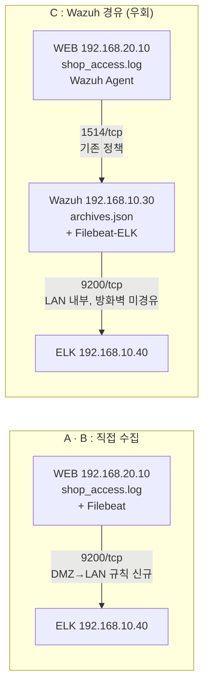

# ELK 구축 가이드라인 — Shadow API 탐지 + 대시보드 (3가지 버전)

> **환경 전제 (팀 문서 기준 실측값)**
> - WEB(192.168.20.10, Ubuntu, 2 vCPU / 2 GB): 쇼핑몰 Apache + PHP가 **Docker 컨테이너**로 동작, 로그는 호스트 디렉터리에 볼륨 마운트
> - Wazuh(192.168.10.30): 4.14.9 올인원, **Archives(logall_json) 활성화** — WEB 액세스 로그가 이미 `archives.json`에 모이고 있음
> - DMZ·LAN 모두 인터넷 불가(폐쇄망) → 패키지는 **오프라인 반입**
> - ELK는 컨테이너 없이 **네이티브 패키지**로 설치
>
> `192.168.10.40`(ELK 서버), pfSense 인터페이스 주소, VIP/포트포워딩 포트(`8083`)는 **예시**다.
> 버전은 반입 시점 Elastic 최신 버전을 쓰며, 명령은 8.x/9.x 공통 절차를 따른다.

---

## 0. 세 가지 버전 한눈에 보기

ELK 설치(2~4장)·명세 대조(5장)·대시보드(7장)는 **세 버전 모두 같다.** 달라지는 것은 **로그를 ELK로 보내는 경로(6장)**와 **방화벽 작업**뿐이다.

| | **A. 현버전 (FortiGate)** | **B. pfSense 버전** | **C. 현버전 우회** |
|---|---|---|---|
| 방화벽 | FortiGate (현재) | pfSense (교체 예정) | FortiGate (현재) |
| 수집 경로 | WEB Filebeat → ELK | WEB Filebeat → ELK | WEB Wazuh Agent → **Wazuh archives.json** → Filebeat → ELK |
| Filebeat 위치 | WEB (DMZ) | WEB (DMZ) | Wazuh 서버 (LAN) |
| 신규 방화벽 작업 | DMZ→LAN 9200 정책 + Kibana VIP | DMZ→LAN 9200 규칙 + Kibana 포트포워딩 | **없음** (Kibana 접속만 6-C 참고) |
| 현재 실행 가능 여부 | ✗ 라이선스 정책 수 한도로 정책 추가 불가 | pfSense 전환 후 가능 | **지금 바로 가능** |
| 지연 | 실시간 (초 단위) | 실시간 | Wazuh 처리 후 전달 (수 초 추가) |
| Wazuh 의존 | 없음 | 없음 | Wazuh 장애 시 ELK 수집도 중단 |
| WEB 부하 | Filebeat 추가 (~50–100 MB RAM) | 동일 | 추가 없음 |
| 권장 상황 | 정책 여유가 생겼을 때 | **최종 목표 구성** | pfSense 전환 전 **당장 시작할 때** |

**권장 순서**: 지금은 **C로 시작** → pfSense 전환 후 **B로 이전** (6-B만 추가하고 6-C 중지. 2~5장·7장은 그대로 재사용).



공통 데이터 흐름:

```
[WEB 컨테이너] Apache /var/log/apache2/shop_access.log
     │ (볼륨 마운트)
[WEB 호스트]   /home/ubuntu/sesac_shop_web_php/logs/apache/shop_access.log
     │ A·B: Filebeat가 직접 읽음          C: Wazuh Agent → archives.json(full_log) → Filebeat
[ELK]          ingest pipeline: api-access
                 ① 원문 파싱 (메서드·경로·상태코드·IP)
                 ② 경로 정규화  /api/v1/users/1 → /api/v1/users/{id}
                 ③ api-inventory(명세)와 enrich 대조
                 ④ api.classification = documented | shadow | zombie
               → Kibana 대시보드
```

---

## 1. 사전 준비 (공통)

### 1-1. ELK 서버 사양 (단일 노드, 파일럿 기준)

| 항목 | 최소 | 비고 |
|---|---|---|
| CPU | 4 vCPU | |
| RAM | 8 GB | JVM 힙 4 GB + OS 파일 캐시 |
| 디스크 | 100 GB | 로그량에 따라 조정, 보관 30일 기준 |
| 위치 | LAN (192.168.10.0/24, VMnet1) | Wazuh indexer도 9200을 쓰므로 **Wazuh VM과 같은 VM에 두지 않는다** |

> ⚠️ **호스트 PC 메모리 확인 필수**: 기존 VM(방화벽 2 GB + WEB 2 GB + DB + Wazuh 8 GB)에 ELK 8 GB가 더해진다. 여유가 없으면 [01 비교 문서 5장](01_Prometheus_vs_Kibana_비교.md)의 **Wazuh 스택 재활용안**을 택한다.

### 1-2. 수집 대상 로그 (실측 경로)

| 위치 | 경로 | 포맷 | 사용 버전 |
|---|---|---|---|
| WEB 컨테이너 내부 | `/var/log/apache2/shop_access.log` | Apache combined | (참고) |
| **WEB 호스트 (볼륨 마운트)** | `/home/ubuntu/sesac_shop_web_php/logs/apache/shop_access.log` | Apache combined | **A · B** |
| **Wazuh 서버** | `/var/ossec/logs/archives/archives.json` | JSON Lines — `location`=위 호스트 경로, `full_log`=원문 한 줄 | **C** |

같은 경로로 들어오는 다른 WEB 로그 (현재 가이드에서는 사용하지 않음):

| 로그 | 호스트 경로 | 활용 가능성 |
|---|---|---|
| 앱 감사 로그 | `/home/ubuntu/sesac_shop_web_php/logs/app.log` (JSON) | API 경로·메서드·상태·`duration_ms` 포함 → 응답시간 패널, 교차검증용 |
| Apache 에러 로그 | `/home/ubuntu/sesac_shop_web_php/logs/apache/shop_error.log` | 존재하지 않는 스크립트 호출 탐지 보조 |
| Docker stdout | `/var/lib/docker/containers/*/*-json.log` | PHP 런타임 예외 |

> ⚠️ **클라이언트 IP 확인**: 컨테이너 Apache 로그 첫 필드가 실제 클라이언트 IP인지, Docker 브리지(`172.x.x.x`)나 방화벽 주소로 찍히는지 확인한다. 후자라면 7장의 "IP별" 패널 대신 `app.log`의 클라이언트 IP를 쓴다.

### 1-3. 오프라인 반입 (인터넷 되는 관리자 PC)

`https://www.elastic.co/downloads`에서 **같은 버전(VER)**으로 받는다 (팀 문서 `troubleshooting/02` 전략 ③과 같은 반입 방식).

| 파일 | 설치 위치 | 버전 |
|---|---|---|
| `elasticsearch-<VER>-amd64.deb` | ELK 서버 | 공통 |
| `kibana-<VER>-amd64.deb` | ELK 서버 | 공통 |
| `filebeat-<VER>-amd64.deb` | **WEB** (`scp -P 2222 ... ubuntu@192.168.0.141:`) | A · B |
| `filebeat-<VER>-linux-x86_64.tar.gz` | **Wazuh 서버** | C |

각 파일의 `.sha512`도 함께 받아 반입 후 `sha512sum -c <파일>.sha512`로 검증한다.

---

## 2. Elasticsearch 설치 (ELK 서버, 공통)

```bash
sudo dpkg -i elasticsearch-<VER>-amd64.deb
```

설치 출력의 **`elastic` 초기 비밀번호**는 안전하게 보관하고 **레포에 커밋하지 않는다** (분실 시 `/usr/share/elasticsearch/bin/elasticsearch-reset-password -u elastic`).

`/etc/elasticsearch/elasticsearch.yml`:

```yaml
cluster.name: api-monitoring
node.name: elk-01
network.host: 192.168.10.40
http.port: 9200
# 보안(xpack.security.*)과 TLS는 설치 시 자동 구성됨 — 그대로 둔다
```

`/etc/elasticsearch/jvm.options.d/heap.options`:

```
-Xms4g
-Xmx4g
```

```bash
sudo systemctl daemon-reload
sudo systemctl enable --now elasticsearch
curl --cacert /etc/elasticsearch/certs/http_ca.crt -u elastic https://192.168.10.40:9200
```

## 3. Kibana 설치 (ELK 서버, 공통)

```bash
sudo dpkg -i kibana-<VER>-amd64.deb
```

`/etc/kibana/kibana.yml`:

```yaml
server.host: "192.168.10.40"
server.port: 5601
```

```bash
TOKEN=$(sudo /usr/share/elasticsearch/bin/elasticsearch-create-enrollment-token -s kibana)
sudo /usr/share/kibana/bin/kibana-setup --enrollment-token "$TOKEN"
sudo systemctl enable --now kibana
```

외부 접속 방법은 버전별로 다르다 (6-A / 6-B / 6-C의 "Kibana 접속"). 이후 API 요청은 **Kibana > Dev Tools**에서 실행한다.

## 4. 전송 전용 API 키 (공통)

```json
POST /_security/api_key
{
  "name": "filebeat-api-access",
  "role_descriptors": {
    "filebeat_writer": {
      "cluster": ["monitor", "read_ilm", "read_pipeline"],
      "index": [{ "names": ["filebeat-*"], "privileges": ["view_index_metadata", "create_doc", "auto_configure"] }]
    }
  }
}
```

응답의 `id:api_key`를 Filebeat에 쓴다. **문서 쓰기만** 가능한 키라 Filebeat가 놓인 서버가 침해돼도 조회·삭제는 못 한다. 키 값은 레포에 커밋하지 않는다.

---

## 5. 명세 적재 · 수집 파이프라인 (공통)

### 5-1. 인벤토리 인덱스

```json
PUT api-inventory
{
  "mappings": {
    "properties": {
      "endpoint_key": { "type": "keyword" },
      "service":      { "type": "keyword" },
      "owner":        { "type": "keyword" },
      "status":       { "type": "keyword" }
    }
  }
}
```

`endpoint_key` 규칙: `"<METHOD> <정규화 경로>"` — 예: `GET /api/v1/users/{id}`
`status`: `active` 또는 `deprecated` (deprecated가 관측되면 Zombie)

### 5-2. OpenAPI 명세 → 인벤토리 적재

```bash
pip install pyyaml   # 명세가 YAML일 때만 필요 (JSON이면 생략)
python tools/openapi_to_inventory.py openapi.yaml shop-api 웹팀 /api/v1 > inventory.ndjson
curl --cacert http_ca.crt -u elastic -X POST "https://192.168.10.40:9200/api-inventory/_bulk" \
     -H "Content-Type: application/x-ndjson" --data-binary @inventory.ndjson
```

- 4번째 인자는 명세 `servers.url`의 경로 prefix(있을 때만). 쇼핑몰 API는 `/api/v1/...` 형태다.
- Windows Git Bash에서는 `/api/v1`이 Windows 경로로 바뀌므로 앞에 `MSYS_NO_PATHCONV=1`을 붙인다.
- 명세가 없으면 비워 둔다 — 전부 shadow로 잡히며, 그 목록이 곧 "명세 작성이 필요한 목록"이다.

### 5-3. Enrich 정책

```json
PUT _enrich/policy/api-inventory-policy
{
  "match": {
    "indices": "api-inventory",
    "match_field": "endpoint_key",
    "enrich_fields": ["service", "owner", "status"]
  }
}

POST _enrich/policy/api-inventory-policy/_execute
```

> ⚠️ **인벤토리를 수정할 때마다 `_execute`를 다시 실행**해야 반영된다.

### 5-4. Ingest pipeline — A·B·C 공용

원문 위치가 버전마다 다르다: A·B는 `message`, C는 `wazuh.full_log`. 첫 두 단계에서 `event.original`로 모은 뒤 같은 처리를 한다.

```json
PUT _ingest/pipeline/api-access
{
  "description": "Apache 액세스 로그 → 파싱 → 경로 정규화 → 명세 대조 (직접 수집·Wazuh 경유 공용)",
  "processors": [
    { "set": { "if": "ctx.wazuh?.full_log != null", "field": "event.original", "copy_from": "wazuh.full_log" } },
    { "set": { "if": "ctx.wazuh?.full_log == null", "field": "event.original", "copy_from": "message" } },
    { "grok": {
        "field": "event.original",
        "patterns": [
          "%{IPORHOST:source.ip} %{NOTSPACE:ident} %{NOTSPACE:user.name} \\[%{HTTPDATE:access_ts}\\] \"%{WORD:http.request.method} %{NOTSPACE:url.original} HTTP/%{NUMBER:http.version}\" %{NUMBER:http.response.status_code:int} (?:%{NUMBER:http.response.body.bytes:long}|-)(?: \"%{DATA:http.request.referrer}\" \"%{DATA:user_agent.original}\")?.*"
        ]
    }},
    { "date":   { "field": "access_ts", "formats": ["dd/MMM/yyyy:HH:mm:ss Z"] } },
    { "remove": { "field": ["access_ts", "ident", "message"], "ignore_missing": true } },

    { "set":  { "field": "url.path", "copy_from": "url.original" } },
    { "gsub": { "field": "url.path", "pattern": "\\?.*$", "replacement": "" } },

    { "set":  { "field": "api.endpoint", "copy_from": "url.path" } },
    { "gsub": { "field": "api.endpoint", "pattern": "[0-9a-fA-F]{8}-[0-9a-fA-F]{4}-[0-9a-fA-F]{4}-[0-9a-fA-F]{4}-[0-9a-fA-F]{12}", "replacement": "{id}" } },
    { "gsub": { "field": "api.endpoint", "pattern": "/[0-9a-fA-F]{16,}(?=/|$)", "replacement": "/{id}" } },
    { "gsub": { "field": "api.endpoint", "pattern": "/\\d+(?=/|$)", "replacement": "/{id}" } },
    { "gsub": { "field": "api.endpoint", "pattern": "(?<=.)/$", "replacement": "" } },

    { "set":    { "field": "api.endpoint_key", "value": "{{http.request.method}} {{api.endpoint}}" } },
    { "enrich": { "policy_name": "api-inventory-policy", "field": "api.endpoint_key", "target_field": "api.inventory", "ignore_missing": true } },
    { "script": {
        "source": "if (ctx.api.inventory == null) { ctx.api.classification = 'shadow'; } else if (ctx.api.inventory.status == 'deprecated') { ctx.api.classification = 'zombie'; } else { ctx.api.classification = 'documented'; }"
    }}
  ],
  "on_failure": [
    { "set": { "field": "error.message", "value": "{{ _ingest.on_failure_message }}" } }
  ]
}
```

### 5-5. 배포 전 시뮬레이션 (필수)

```json
POST _ingest/pipeline/api-access/_simulate
{
  "docs": [
    { "_source": { "message": "203.0.113.5 - - [29/Oct/2026:10:00:00 +0900] \"GET /api/v1/users/1?x=1 HTTP/1.1\" 200 512 \"-\" \"curl/8.0\"" } },
    { "_source": { "wazuh": {
        "location": "/home/ubuntu/sesac_shop_web_php/logs/apache/shop_access.log",
        "full_log": "203.0.113.5 - - [29/Oct/2026:10:00:01 +0900] \"POST /debug/reset HTTP/1.1\" 404 0"
    }}}
  ]
}
```

기대 결과: 첫 문서(A·B 형태) `api.endpoint_key = "GET /api/v1/users/{id}"`, 두 번째 문서(C 형태) `api.classification = "shadow"`.
실제 로그 한 줄로도 확인한다:
- A·B: `tail -1 /home/ubuntu/sesac_shop_web_php/logs/apache/shop_access.log`
- C: `sudo grep shop_access.log /var/ossec/logs/archives/archives.json | tail -1`

### 5-6. 정규화 규칙의 한계

| 상황 | 결과 | 대응 |
|---|---|---|
| 경로 파라미터가 문자열 (`/users/alice`) | 정규화 안 됨 → shadow 오탐 | 해당 패턴용 `gsub` 추가 (예: `/users/[^/]+` → `/users/{id}`) |
| `/api/v1` 같은 명세 prefix 누락 | 전부 shadow | 5-2의 prefix 인자 확인 |
| 정적 파일 (`/css/...`, `.php` 페이지, `/favicon.ico`) | shadow로 잡힘 | 대시보드 제외 필터, 또는 파이프라인에서 `drop` |

---

## 6. 로그 수집 — 버전별

### 6-A. 현버전 (FortiGate) — WEB 직접 수집

> ⚠️ 현재 FortiGate 평가판 라이선스의 **정책 수 한도로 아래 정책을 추가할 수 없다.** 정책 여유가 생길 때를 대비한 절차다.

**FortiGate 설정**

| 항목 | 값 |
|---|---|
| 정책 (DMZ→LAN) | Incoming `port3` → Outgoing `port2`, Source `192.168.20.10/32`, Destination `192.168.10.40/32`, Service `TCP/9200`, Action ACCEPT, **NAT 해제** |
| Kibana 접속 | VIP `192.168.0.141:8083 → 192.168.10.40:5601` 생성 후 WAN→LAN 정책 목적지에 추가, Source는 관리자 IP로 제한 |

**Filebeat (WEB)**: 아래 [6-AB 공통 Filebeat](#6-ab-공통-filebeat-web-서버) 절차.

### 6-B. pfSense 버전 — WEB 직접 수집

pfSense는 규칙 수 제한이 없으므로 A와 같은 구성을 그대로 만든다. 인터페이스는 `WAN`, `LAN`(192.168.10.0/24), `OPT1`→이름 `DMZ`(192.168.20.0/24)로 가정한다.

**pfSense 설정**

| 메뉴 | 설정 |
|---|---|
| Firewall > Aliases | `ELK_SRV` = `192.168.10.40`, `WAZUH_SRV` = `192.168.10.30`, `WEB_SRV` = `192.168.20.10` |
| Firewall > Rules > **DMZ** | Pass · TCP · Source `WEB_SRV` · Destination `ELK_SRV` port `9200` · 설명 "Filebeat → ELK" |
| Firewall > Rules > **DMZ** | Pass · TCP · Source `WEB_SRV` · Destination `WAZUH_SRV` port `1514-1515` · 설명 "Wazuh Agent" (기존 FortiGate 정책 이관) |
| Firewall > Rules > **DMZ** (맨 아래) | Block · Source `DMZ net` · Destination `LAN net` · 로그 ON — 위 두 규칙 외 DMZ→LAN 차단 |
| Firewall > NAT > Port Forward | Interface `WAN` · TCP · Dest. port `8083` → Redirect `ELK_SRV:5601` · Source는 관리자 IP로 제한 · "Add associated filter rule" 선택 |

- pfSense 규칙은 **위에서부터 처음 일치하는 규칙**이 적용된다. Pass 규칙을 Block 규칙보다 위에 둔다.
- 기존 Wazuh 대시보드 VIP(`:8082` 등)와 WEB 서비스(`:8080`), SSH(`:2222`) 포트포워딩도 함께 이관한다.
- (선택) **Status > System Logs > Settings > Remote Logging**으로 방화벽 로그를 Wazuh `192.168.10.30:514`에 보내면, WEB(Apache)을 거치지 않고 다른 포트로 직접 들어온 시도도 볼 수 있다 (10장 자산 축 보강). 단, 팀 로그 명세서는 ML 노이즈 때문에 방화벽 Syslog를 제외했으므로 Shadow API 점검용으로만 짧게 켠다. Wazuh `remote` 설정의 `allowed-ips`가 pfSense LAN 주소와 맞는지 확인한다.

**Filebeat (WEB)**: 아래 6-AB 공통 절차.

**C → B 이전 시**: 6-AB로 WEB Filebeat를 켠 뒤 Wazuh 서버의 `filebeat-elk`를 `systemctl disable --now filebeat-elk`로 끈다. 둘 다 켜 두면 같은 요청이 두 번 들어간다.

### 6-AB. 공통 Filebeat (WEB 서버)

WEB에는 다른 Filebeat가 없으므로 deb로 설치한다.

```bash
# 관리자 PC → WEB 반입 (기존 SSH 포트포워딩 사용)
scp -P 2222 filebeat-<VER>-amd64.deb ubuntu@192.168.0.141:/home/ubuntu/
# ELK 서버의 /etc/elasticsearch/certs/http_ca.crt 도 같은 방식으로 WEB /etc/filebeat/http_ca.crt 로 복사

ssh -p 2222 ubuntu@192.168.0.141
sudo dpkg -i /home/ubuntu/filebeat-<VER>-amd64.deb
```

`/etc/filebeat/filebeat.yml`:

```yaml
filebeat.inputs:
  - type: filestream
    id: web-shop-access
    paths:
      - /home/ubuntu/sesac_shop_web_php/logs/apache/shop_access.log   # 컨테이너 /var/log/apache2 의 호스트 마운트 경로
    pipeline: api-access
    fields:
      zone: dmz
      host_role: web

output.elasticsearch:
  hosts: ["https://192.168.10.40:9200"]
  api_key: "<id>:<api_key>"
  ssl.certificate_authorities: ["/etc/filebeat/http_ca.crt"]
```

```bash
# 인덱스 템플릿 초기 설정은 1회만 관리자 계정으로:
# filebeat.yml의 api_key 줄을 잠시 주석 처리한 뒤 실행하고, 끝나면 되돌린다
sudo filebeat setup --index-management \
  -E output.elasticsearch.username=elastic -E output.elasticsearch.password='<비밀번호>'

sudo filebeat test config && sudo filebeat test output
sudo systemctl enable --now filebeat
```

- 컨테이너 **안**의 `/var/log/apache2/...`가 아니라 **호스트**의 마운트 경로를 읽는다. 컨테이너를 재생성해도 경로가 유지된다.
- Wazuh Agent도 같은 파일을 읽지만 읽기만 하므로 충돌하지 않는다.

### 6-C. 현버전 우회 — Wazuh archives 경유

WEB 로그는 이미 Wazuh Agent가 기존 정책(1514/tcp)으로 Wazuh 서버에 보내고 있다. **Wazuh 서버 → ELK는 같은 LAN이라 방화벽을 거치지 않는다.** 그래서 방화벽 정책을 하나도 추가하지 않고 수집할 수 있다.

**왜 tar.gz로 따로 설치하나**: Wazuh 서버에는 Wazuh가 쓰는 Filebeat(deb, `/etc/filebeat`, `filebeat.service`)가 이미 있다. 같은 deb를 또 설치하면 충돌하므로 ELK 전송용은 tar.gz로 `/opt/filebeat-elk`에 따로 두고 서비스 이름도 `filebeat-elk`로 분리한다. **기존 Wazuh Filebeat 설정은 건드리지 않는다.**

```bash
sudo tar xzf filebeat-<VER>-linux-x86_64.tar.gz -C /opt
sudo mv /opt/filebeat-<VER>-linux-x86_64 /opt/filebeat-elk
# ELK 서버의 http_ca.crt 를 /opt/filebeat-elk/http_ca.crt 로 복사
```

`/opt/filebeat-elk/filebeat.yml` (기존 내용을 아래로 교체):

```yaml
filebeat.inputs:
  - type: filestream
    id: wazuh-archives-web-access
    paths:
      - /var/ossec/logs/archives/archives.json
    parsers:
      - ndjson:
          target: "wazuh"
          add_error_key: true
    processors:
      - drop_event:
          when:
            not:
              contains:
                wazuh.location: "shop_access.log"
    pipeline: api-access

output.elasticsearch:
  hosts: ["https://192.168.10.40:9200"]
  api_key: "<id>:<api_key>"
  ssl.certificate_authorities: ["/opt/filebeat-elk/http_ca.crt"]

path.data: /opt/filebeat-elk/data
path.logs: /opt/filebeat-elk/logs
```

```bash
cd /opt/filebeat-elk
sudo chown root:root filebeat.yml && sudo chmod 600 filebeat.yml
# 템플릿 초기 설정 (api_key 줄 잠시 주석 처리 후 실행, 끝나면 되돌림)
sudo ./filebeat setup --index-management -c filebeat.yml \
  -E output.elasticsearch.username=elastic -E output.elasticsearch.password='<비밀번호>'
sudo ./filebeat test config -c filebeat.yml && sudo ./filebeat test output -c filebeat.yml
```

`archives.json`은 `wazuh` 그룹만 읽을 수 있으므로 root로 실행한다. `/etc/systemd/system/filebeat-elk.service`:

```ini
[Unit]
Description=Filebeat (Wazuh archives -> ELK)
After=network-online.target wazuh-manager.service

[Service]
ExecStart=/opt/filebeat-elk/filebeat -c /opt/filebeat-elk/filebeat.yml --path.home /opt/filebeat-elk
Restart=always

[Install]
WantedBy=multi-user.target
```

```bash
sudo systemctl daemon-reload
sudo systemctl enable --now filebeat-elk
sudo systemctl status filebeat wazuh-manager filebeat-elk   # 기존 Wazuh filebeat도 정상인지 같이 확인
```

**Kibana 접속 (C)**: 정책을 추가하지 않는 방법 중 하나를 쓴다.
1. 기존 Wazuh 대시보드용 WAN→LAN 정책의 **목적지에** Kibana VIP(`192.168.0.141:8083 → 192.168.10.40:5601`)를 추가한다. 정책 수는 그대로다. FortiGate 담당자와 확인 후 적용.
2. Wazuh 서버를 경유한 SSH 터널: `ssh -L 5601:192.168.10.40:5601 <wazuh 접속 경로>` 후 `http://localhost:5601`.

**주의**
- Wazuh는 `archives.json`을 매일 회전(`archives/YYYY/Mon/`로 압축 이동)한다. Filebeat는 현재 파일만 따라가므로 문제없다.
- 처음 시작하면 현재 `archives.json` 전체를 읽는다. 과거분을 빼려면 입력에 `ignore_older: 1h`를 둔다.
- Wazuh 서버 디스크(50 GB)는 Archives만으로도 빠르게 찬다. archives 보관 주기를 함께 점검한다.

### 6-D. 수집 확인 (공통)

```json
GET filebeat-*/_search
{
  "size": 0,
  "aggs": { "by_class": { "terms": { "field": "api.classification" } } }
}
```

`documented / shadow / zombie` 건수가 나오면 성공. `error.message`가 있는 문서는 grok 불일치 → 5-5에 실제 로그 한 줄을 넣어 원인 확인.

---

## 7. 보관 정책 · 대시보드 (공통)

**ILM**: Kibana > Stack Management > Index Lifecycle Policies > `filebeat` → Delete **30일 후 삭제** (내부 정책에 맞춰 조정).

**Data View**: `filebeat-*` (시간 필드 `@timestamp`). **Dashboards > Create**에서 Lens로 구성:

| # | 패널 | 시각화 | 설정 |
|---|---|---|---|
| 1 | 분류별 요청 수 | Metric ×3 | `api.classification` = documented / shadow / zombie 각각 Count |
| 2 | 분류별 추이 | 누적 막대(시간축) | X: `@timestamp`, 분할: `api.classification` |
| 3 | **Shadow API 목록** | Table | 필터 `api.classification: shadow` · 행: `api.endpoint_key` · 열: Count, Min `@timestamp`(최초 발견), Max `@timestamp`(최근), Unique count `source.ip` |
| 4 | Zombie API 목록 | Table | 필터 `api.classification: zombie` · 행: `api.endpoint_key`, `api.inventory.owner` · 열: Count, Max `@timestamp` |
| 5 | 상태코드 분포 | 도넛 | `http.response.status_code` |
| 6 | 호출 상위 IP | 막대 | `source.ip` Top 10 (1-2의 클라이언트 IP 확인 후) |
| 7 | 전체 트래픽 | 라인 | Count over `@timestamp` |

> 오탐 정리: Shadow 목록에서 정상 API는 명세에 추가(→ 5-2 재적재 → 5-3 `_execute`), 정적 파일은 제외 필터에 추가. 반복할수록 목록이 "진짜 Shadow"로 수렴한다.

## 8. 알림 (선택)

| 방법 | 내용 | 비고 |
|---|---|---|
| Kibana Alerting | `Elasticsearch query` 규칙: 최근 5분 `api.classification: shadow` > 0 | Basic 라이선스는 커넥터 제한, 폐쇄망이라 외부 알림 불가 |
| **Wazuh 연동 (권장)** | 주기 스크립트가 신규 shadow 엔드포인트 조회 → JSON 로그 파일 기록 → Wazuh 수집 → Wazuh 규칙으로 경보 | 기존 관제 화면에서 함께 확인 |

## 9. 자산 축 연계

트래픽이 없는 엔드포인트(Dormant)와 Apache를 거치지 않는 서비스는 액세스 로그에 안 보인다.

| 수단 | 버전 | 내용 |
|---|---|---|
| Wazuh syscollector | 공통 | **IT Hygiene > Network ports**에서 WEB 리스닝 포트 확인. Docker 포트 매핑은 `docker-proxy`로 보인다. 승인 외 포트 = 점검 대상 |
| 포트포워딩 목록 대조 | 공통 | FortiGate VIP / pfSense NAT Port Forward 목록(`192.168.0.141:*`)과 대조해 외부 노출 여부 확인 |
| 방화벽 로그 | B | 6-B의 Remote Logging으로 WEB 우회 접근 시도 확인 |

→ 명세(5장) × 트래픽(6~7장) × 자산(9장) = 3원 대조.

## 10. 버전별 체크리스트

| 단계 | A. FortiGate | B. pfSense | C. 우회 |
|---|---|---|---|
| 1 | ELK VM 확보 (1-1) | 동일 | 동일 |
| 2 | 패키지 반입 (1-3): ES·Kibana·**Filebeat deb** | 동일 | ES·Kibana·**Filebeat tar.gz** |
| 3 | ES·Kibana·API 키 (2~4장) | 동일 | 동일 |
| 4 | 명세·파이프라인·시뮬레이션 (5장) | 동일 | 동일 |
| 5 | FortiGate 정책 + VIP (6-A) | pfSense 규칙 + 포트포워딩 (6-B) | 방화벽 작업 없음 |
| 6 | WEB Filebeat (6-AB) | WEB Filebeat (6-AB) | Wazuh 서버 filebeat-elk (6-C) |
| 7 | 수집 확인 (6-D) | 동일 | 동일 + 기존 Wazuh filebeat 정상 확인 |
| 8 | ILM·대시보드 (7장) | 동일 | 동일 |
| 9 | 1주 오탐 정리 → 알림·자산 축 (8~9장) | 동일 | 동일 |

## 11. 보안 주의사항

- `elastic` 비밀번호, API 키, Wazuh admin 비밀번호는 문서·레포에 남기지 않는다 (CONTRIBUTING 규칙).
- 액세스 로그 쿼리스트링에 토큰·개인정보가 있을 수 있다 → 필요 시 파이프라인에서 `url.original` 쿼리 부분을 마스킹하거나 `url.path`만 남긴다.
- 일상 조회용 Kibana 계정은 `elastic`과 별도로 만든다.
- Kibana(5601)를 WAN에 열 때는 Source를 관리자 IP로 제한한다.
- A·B에서 DMZ→LAN 허용은 `WEB → ELK:9200` 한 건으로 한정하고, 나머지 DMZ→LAN은 차단·로그한다.
